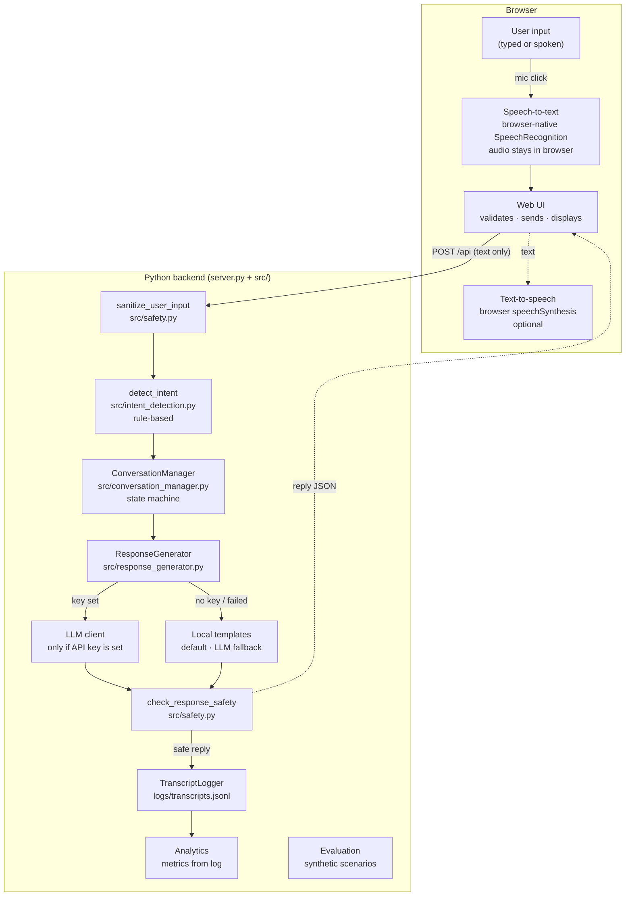
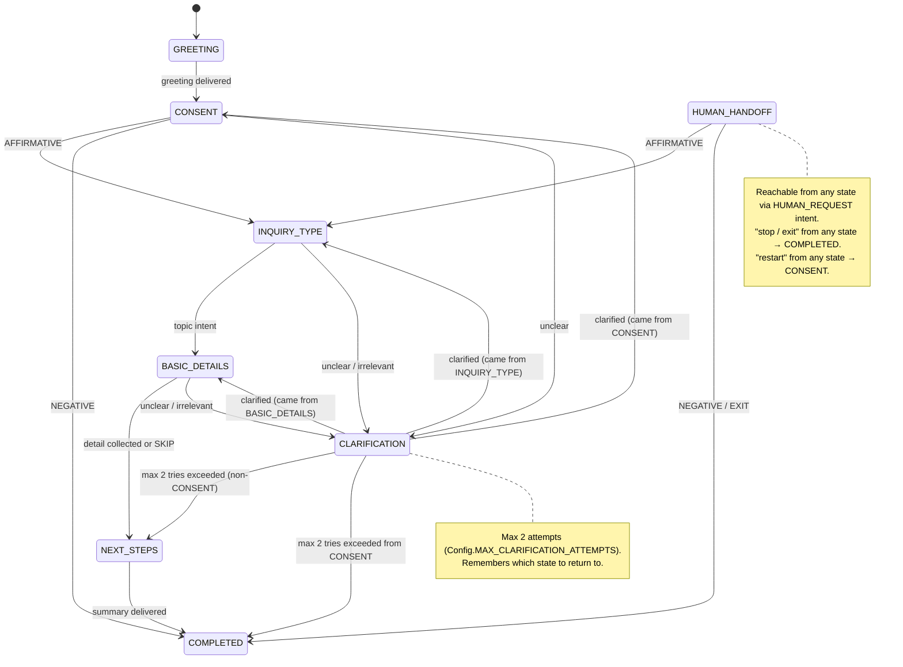
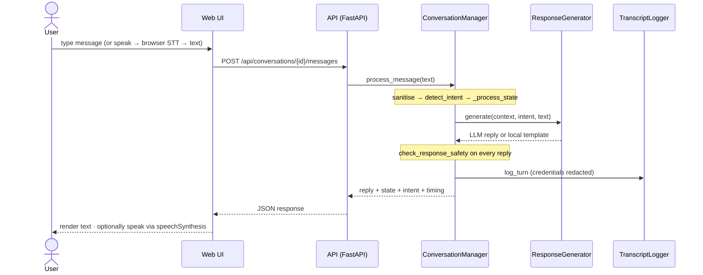
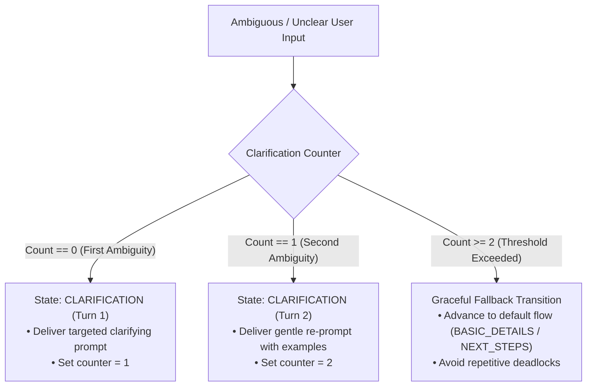
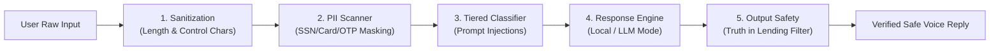
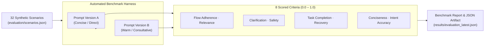

<div align="center">

# VoiceBridge AI

### Conversational Intelligence, Designed to Feel Human.

A voice-enabled conversational AI **educational prototype** demonstrating dialogue-state management,
prompt engineering, error recovery, safety checks, and systematic evaluation.

[](https://www.python.org/)
[](https://fastapi.tiangolo.com/)
[](https://github.com/OjusGupta/VoiceBridge-AI-/actions/workflows/ci.yml)
[](LICENSE)
[](README.md)

> **Not financial advice.** VoiceBridge AI is an educational prototype. It is not a lender, does not connect to any bank, and never makes real loan decisions. See [Limitations](#limitations).

</div>

---

**Navigate:** [Overview](#overview) · [Features](#features) · [Screenshots](#screenshots) · [How it works](#how-it-works) · [Architecture](#architecture) · [States](#conversation-states) · [Safety](#safety--privacy) · [Evaluation](#evaluation) · [Voice support](#voice-support) · [Quick start](#quick-start) · [Usage](#usage) · [Testing](#testing) · [Project structure](#project-structure) · [API reference](#api-reference) · [Troubleshooting](#troubleshooting) · [Limitations](#limitations) · [Roadmap](#roadmap)

---

## Overview

VoiceBridge AI is a single-page web application backed by a FastAPI server. It guides a user through a simulated loan-inquiry conversation using a deterministic state machine, rule-based intent detection, an optional OpenAI-compatible LLM, and a suite of safety checks that run on every reply regardless of how it was generated.

Typed and spoken messages travel through exactly the same pipeline. Voice input uses the browser's built-in speech recognition (Chrome/Edge); voice output uses browser `speechSynthesis`. No audio is ever sent to the server — the Python backend only ever sees plain text.

## Why this exists

Building a responsible conversational AI requires more than a language model. This project demonstrates:

- **Dialogue-state management** — a finite-state machine that can never wander off-topic
- **Structured intent detection** — keyword/rule-based classification that is readable and testable without ML infrastructure
- **Output safety checks** — every reply, including LLM replies, is validated before it reaches the user
- **A/B prompt comparison** — two wording styles evaluated against the same scenario suite
- **Systematic evaluation** — a scenario-replay harness with 8 scored criteria and a clear caveat that the scenarios are synthetic

## Features

| Feature | Detail |
|---|---|
| Chat interface | Conversation workspace: typed or spoken input, spoken replies, restart, end, state + progress indicator |
| Voice input | Browser-native `SpeechRecognition`; Chrome/Edge; audio processed by browser vendor's cloud service |
| Voice output | Browser-native `speechSynthesis`; local to device; no network |
| Transcripts page | Filter by session / prompt / state, full-text search, CSV + JSON export, delete logs |
| Evaluation Lab | Run 32 synthetic scenarios; per-criterion scores; Prompt A vs B; failure details |
| Analytics page | Real usage metrics (sessions, completion rate, intent distribution, avg response time) |
| System Architecture | Three live SVG diagrams (system, state machine, sequence) with zoom and a glossary |
| Settings | Prompt A/B toggle, spoken replies, voice conversation mode, speech rate, LLM status, clear history |
| Local demo mode | Fully deterministic template replies; works with no API key |
| LLM mode | OpenAI-compatible API; key stays server-side; output still safety-checked |

---

## Screenshots

> **To add screenshots:** run the server (`uvicorn server:app --port 8000`), open Chrome at `http://localhost:8000`, capture each page at 1280 px wide (dark theme is default), and save under `docs/images/` with the filenames listed below. Then push. The README will render them automatically.

| Page | File to add |
|---|---|
| Chat (full conversation) | `docs/images/chat.png` |
| Transcripts | `docs/images/transcripts.png` |
| Evaluation Lab | `docs/images/evaluation.png` |
| Analytics | `docs/images/analytics.png` |
| System Architecture | `docs/images/architecture.png` |
| Settings | `docs/images/settings.png` |
| Chat — mobile (390 px) | `docs/images/chat-mobile.png` |

<!-- Uncomment and adjust once the images are in docs/images/:


<details>
<summary>More screenshots</summary>

| Transcripts | Evaluation Lab |
|---|---|
|  |  |

| Analytics | Settings |
|---|---|
|  |  |


</details>
-->

---

## How it works

### One message, step by step

1. The browser validates the input (non-empty, ≤ 2 000 chars) and blocks duplicate sends while one is in flight.
2. `POST /api/conversations/{id}/messages` — the backend validates again.
3. **`sanitize_user_input`** — strips control characters, truncates.
4. **`detect_intent`** — rule-based keyword matching classifies the message into one of 17 `UserIntent` values. Priority order: sensitive info → exit/restart → safety intents → topic intents → control intents → sentiment → fallback.
5. **`ConversationManager._process_state`** — the current state and intent determine the next state and which handler runs.
6. **`ResponseGenerator.generate`** — tries the LLM if configured; falls back to local templates if not, or if the LLM call fails.
7. **`check_response_safety`** — runs on every reply (LLM and local). Unsafe output is replaced by a safe fallback.
8. **`TranscriptLogger.log_turn`** — appends a JSON line to `logs/transcripts.jsonl`. Credentials in user input are redacted before writing.
9. JSON response → browser renders it as text (never as HTML) and optionally speaks it.

### Try it in 2 minutes

Start the server, open `http://localhost:8000` in Chrome or Edge, then try these prompts in order:

```
"Yes, let's get started"          → moves from CONSENT to INQUIRY_TYPE
"What types of loans are there?"  → answers, moves to BASIC_DETAILS
"I want to learn more"            → collects detail, moves to NEXT_STEPS
"What are the next steps?"        → delivers summary, COMPLETED
```

Or explore edge cases:

```
"I want to speak to a human"      → HUMAN_HANDOFF detour; then "yes" continues
"stop"                            → exits from any state
"restart"                         → resets to CONSENT, keeps session ID
"My SSN is 123-45-6789"           → sensitive info detected, redacted in log
"Can you guarantee my loan?"      → safety check triggers, refuses to guarantee
```

---

## Architecture

The three diagrams below are derived directly from the source code. They are also committed as SVGs in `docs/images/` for offline viewing.

### System architecture



### Conversation state machine



### Request/response sequence



See [`docs/ARCHITECTURE.md`](docs/ARCHITECTURE.md) for a full prose walkthrough, and [`docs/images/`](docs/images/) for standalone SVG versions of all three diagrams.

---

## Conversation states

| State | Description | Transitions |
|---|---|---|
| `GREETING` | Initial greeting delivered | → CONSENT |
| `CONSENT` | Asks if user wants to continue | AFFIRMATIVE → INQUIRY_TYPE · NEGATIVE → COMPLETED · unclear → CLARIFICATION |
| `INQUIRY_TYPE` | Asks which topic interests the user | topic intent → BASIC_DETAILS · unclear → CLARIFICATION |
| `BASIC_DETAILS` | Collects optional detail about the topic | any reply → NEXT_STEPS · SKIP → NEXT_STEPS · unclear → CLARIFICATION |
| `CLARIFICATION` | Asks the user to clarify (max 2 tries) | clear reply → returns to source state · max tries → moves on |
| `NEXT_STEPS` | Delivers guidance on next steps | → COMPLETED |
| `HUMAN_HANDOFF` | Explains a human cannot be connected; offers to continue | AFFIRMATIVE → INQUIRY_TYPE · NEGATIVE/EXIT → COMPLETED |
| `COMPLETED` | Conversation has ended | input disabled; Restart available |

**Cross-state intents** (work from any state): `EXIT` → COMPLETED · `RESTART` → CONSENT · `HUMAN_REQUEST` → HUMAN_HANDOFF · `SENSITIVE_INFO`, `GUARANTEE_REQUEST`, `RATE_REQUEST` → handled inline.

### Clarification & Recovery Flow



---

## Safety & privacy

### Multi-Layer Safety Defense



| Concern | How it is handled |
|---|---|
| Long or malformed input | `sanitize_user_input` truncates to 2 000 chars; strips control characters |
| Sensitive credentials in input | Detected by regex (SSN, card, OTP, password); redacted as `[REDACTED]` before history and log |
| LLM hallucinating loan approvals | `check_response_safety` rejects replies with approval claims, rate quotes, or timing guarantees |
| LLM requesting user credentials | `check_response_safety` rejects replies asking for passwords or card numbers |
| API key exposure | Key is read server-side from `.env`; never returned to the browser |
| Prompt injection | Instruction-override phrases are in the intent detector's safety-critical tier and handled without passing them to the LLM |

Safety checks run on **every** reply — local templates included — so a template bug also gets caught.

---

## Evaluation

### Evaluation Harness Flow



Run the evaluation suite from the CLI:

```bash
python -m evaluation.run_evaluation
```

Or click **Run** in the Evaluation Lab page. Results are written to `results/evaluation_latest.json`.

### What it measures

Eight heuristic criteria, scored 0–1 per scenario:

| Criterion | What it checks |
|---|---|
| Flow adherence | Final state matches `expected_state` |
| Relevance | Reply is not a clarification request on a clear turn |
| Clarification | Clarification is triggered on ambiguous/irrelevant turns |
| Safety | No guarantee/rate/approval claims in any reply |
| Task completion | Reaches COMPLETED for expected completions |
| Recovery | Recovers from off-topic turns without crashing |
| Conciseness | Reply is not unusually long |
| Intent accuracy | Detected intent matches `expected_intents` |

> **Important caveat:** All 32 scenarios in `evaluation/scenarios.json` are **synthetic** — written by the same author who wrote the detector. A pass shows that the pipeline behaves as specified, not that replies are natural or empathetic. In local mode, Prompt A and B share the same state machine and differ only in template wording, so equal pass rates are expected by construction. A meaningful A/B comparison needs LLM mode and human review.

---

## Voice support

| Feature | Status | Detail |
|---|---|---|
| Speech **input** | ✅ Supported in Chrome, Edge | Browser-native `SpeechRecognition`. Audio processed by browser vendor's cloud service. Needs microphone permission, internet, and `http://localhost` or HTTPS. |
| Speech **output** | ✅ Supported | Browser-native `speechSynthesis`. Local to device; no network. Needs an English voice installed. |
| Typing | ✅ Always available | No browser or network dependency. |
| Firefox | ⛔ Not supported | `SpeechRecognition` not implemented. Mic button is disabled with an explanation. |
| Safari | ⚠️ Untested | Partial `SpeechRecognition` support; not tested in this project. |
| Server-side transcription | ⛔ Not implemented | No Whisper, no MediaRecorder upload. Where browser recognition is missing, use typing. |
| Continuous listening | ⛔ Not implemented | One click = one utterance. "Voice conversation" auto-sends and auto-speaks, but you press the mic for each turn. |

**Voice has NOT been tested with a real microphone in this repository's CI.** The voice chip stays amber ("browser-native, untested") until recognition has actually returned text in your session.

**Manual voice test:** Chrome or Edge → `http://localhost:8000` → mic → allow → say *"Yes, let's get started"* → text appears → Send → chip turns green. Tick **Speak replies**, send a message, and confirm you hear the reply.

---

## Quick start

**Requires Python 3.10+.**

```bash
# 1. Clone
git clone https://github.com/OjusGupta/VoiceBridge-AI-.git
cd VoiceBridge-AI-

# 2. Virtual environment (recommended)
python -m venv .venv
# Windows:
.venv\Scripts\activate
# macOS / Linux:
source .venv/bin/activate

# 3. Install
pip install -r requirements.txt

# 4. Run
uvicorn server:app --port 8000
```

Open **http://localhost:8000** in Chrome or Edge. Do **not** open `frontend/index.html` directly from disk — the app uses ES modules and `fetch`, which require the server.

**Optional LLM mode:**

```bash
cp .env.example .env
# Edit .env and set OPENAI_API_KEY=sk-...
# Optionally set OPENAI_BASE_URL for a local model endpoint
uvicorn server:app --port 8000
```

The API key stays on the server. With no key the app runs in **local demo mode** (deterministic templates; all tests pass).

---

## Usage

### Chat

1. The assistant greets you and asks if you want to continue.
2. Say yes to start. Choose a topic: loan types, the application process, or required documents.
3. Provide any optional details when asked, or say **"skip"** / **"next"** to move on.
4. Receive a summary of next steps.
5. Use **Restart** to begin a new conversation, or **End** to close.

### Pages

| Page | Path in nav | What to do |
|---|---|---|
| Chat | default | Converse; click the mic for voice input |
| Transcripts | Transcripts | View, filter, search, export (CSV/JSON), or delete logs |
| Evaluation Lab | Evaluation | Click **Run** to replay 32 scenarios; read per-criterion scores |
| Analytics | Analytics | See real usage metrics and prompt comparison |
| System Architecture | Architecture | Explore the three diagrams; zoom; read the glossary |
| Settings | Settings | Toggle prompt version (A/B), spoken replies, voice mode, speech rate |

---

## Testing

### Backend tests (130 tests)

```bash
pytest -q
# Expected: 130 passed, 1 warning  (~24 s)
```

Tests are split by concern:

| Module | Coverage |
|---|---|
| `test_api.py` | All HTTP endpoints |
| `test_conversation_flow.py` | Full state machine flows |
| `test_evaluation.py` | Evaluator scoring and serialisation |
| `test_recovery.py` | Edge cases: unclear input, handoff, restart, exit, empty input |
| `test_regressions.py` | Named regression guards for past bugs |
| `test_safety.py` | Input sanitisation, output safety, PII detection, prompt injection |
| `test_transcript_logging.py` | Logger read/write, analytics |

Tests **never write to the real `logs/` directory** — `conftest.py` patches `TranscriptLogger` to use a temporary directory.

### Optional browser end-to-end tests

```bash
pip install -r requirements-dev.txt
python -m playwright install chromium

# In one terminal:
uvicorn server:app --port 8765

# In another terminal:
python tests/e2e_browser.py http://localhost:8765   # chat flow, escaping, errors, layout
python tests/e2e_pages.py   http://localhost:8765   # navigation, filters, export, settings
```

These drive the real app and write to the real `logs/`. Delete `logs/transcripts.jsonl` afterwards.
They are **not run in CI** because they require a display and Playwright browser binaries.

---

## Project structure

```
VoiceBridge-AI-/
├── server.py               FastAPI app + static frontend mounting
├── requirements.txt        Core dependencies
├── requirements-dev.txt    Optional: Playwright e2e + legacy Streamlit
├── .env.example            Environment variable reference
├── LICENSE                 MIT
│
├── src/                    Conversation pipeline
│   ├── config.py           Environment + limits
│   ├── schemas.py          Pydantic models (states, intents, turns, context)
│   ├── intent_detection.py Rule-based intent classifier
│   ├── safety.py           Input sanitisation + output safety checks
│   ├── response_generator.py LLM/local response generation
│   ├── llm_client.py       OpenAI-compatible client wrapper
│   ├── conversation_manager.py State machine + turn orchestration
│   ├── transcript_logger.py JSONL logging + session replay
│   └── analytics.py        Aggregate metrics
│
├── prompts/
│   └── conversation_prompts.py  Prompt A and B templates
│
├── evaluation/
│   ├── evaluator.py        Scenario replay + 8-criterion scoring
│   ├── run_evaluation.py   CLI entry point
│   └── scenarios.json      32 synthetic test scenarios
│
├── frontend/               Plain HTML/CSS/JS — no build step
│   ├── index.html
│   ├── css/styles.css
│   └── js/
│       ├── app.js          Router + shared state
│       ├── api.js          fetch wrappers
│       ├── voice.js        SpeechRecognition + speechSynthesis
│       ├── pages.js        All page logic
│       ├── diagrams.js     Hand-drawn SVG diagrams
│       └── prefs.js        localStorage wrapper
│
├── tests/
│   ├── conftest.py         Shared fixtures (temp log dir)
│   ├── test_*.py           130 backend tests
│   └── e2e_*.py            Optional Playwright browser tests
│
├── docs/
│   ├── ARCHITECTURE.md     Full pipeline walkthrough
│   └── images/             SVG diagrams + screenshots (add manually)
│
├── legacy/
│   ├── streamlit_app.py    Original Streamlit UI (superseded, untested)
│   └── README.md           Legacy notice
│
├── logs/                   Runtime transcripts (git-ignored, .gitkeep committed)
└── results/                Evaluation output (git-ignored, .gitkeep committed)
```

---

## API reference

<details>
<summary>Expand API reference</summary>

Interactive docs at **http://localhost:8000/docs** (Swagger UI) when the server is running.

### Status

```
GET /api/status
```

Returns mode (`llm` or `local`), active session count, and storage info.

### Conversations

```
POST   /api/conversations                         Create a conversation; returns greeting
POST   /api/conversations/{id}/messages           Send a message; returns reply + state + intent
POST   /api/conversations/{id}/restart            Reset to a new session; returns greeting
POST   /api/conversations/{id}/end                End the conversation
GET    /api/conversations/{id}/transcript         All turns for this session
```

`POST /api/conversations` body (optional):
```json
{ "prompt_version": "A" }   // "A" (default) or "B"
```

`POST /api/conversations/{id}/messages` body:
```json
{ "message": "Yes, let's get started" }
```

Response fields: `session_id`, `state`, `state_before`, `is_active`, `turn_count`, `reply`, `intent`, `clarification_required`, `fallback_used`, `response_time_ms`.

### Transcripts

```
GET    /api/transcripts                           All turns; filterable by session_id, prompt_version, state, q
GET    /api/transcripts/export?format=csv|json    Download transcripts
DELETE /api/transcripts                           Clear all logs
```

### Analytics

```
GET /api/analytics
```

Returns `summary` (total sessions, completion rate, intent distribution, avg response time) and `prompt_comparison`.

### Evaluation

```
POST /api/evaluation/run      Run all scenarios; save to results/evaluation_latest.json
GET  /api/evaluation/results  Return the latest saved result
```

</details>

---

## Troubleshooting

<details>
<summary>Expand troubleshooting</summary>

**"Cannot reach the backend"**  
The server isn't running, or you opened the file directly. Start `uvicorn server:app --port 8000` and use `http://localhost:8000`.

**Mic button is disabled**  
Either your browser lacks `SpeechRecognition` (use Chrome or Edge), or Voice input is switched off in Settings.

**"Microphone permission was denied"**  
Click the lock icon in the address bar → allow Microphone → try again.

**"Speech recognition needs a network connection"**  
Chrome/Edge use an online service for recognition. Check your internet connection.

**No sound from spoken replies**  
Tick *Speak replies* in Settings; check system volume; ensure your OS has an English voice installed. Some browsers need at least one click on the page before they allow audio.

**"This session no longer exists"**  
The server restarted. Sessions are in-memory and are lost on restart. Press **Restart** to begin a new one.

**Port in use**  
`uvicorn server:app --port 8001` and open `http://localhost:8001`.

**Tests fail with import errors**  
Run pytest from the project root, not from inside `src/` or `tests/`. Ensure the virtualenv is active.

</details>

---

## Limitations

- **Intent detection** is keyword/rule-based. Unusual or complex phrasing can be misclassified.
- **No server-side speech-to-text.** Voice input depends entirely on the browser's `SpeechRecognition` API (Chrome/Edge), which sends audio to the browser vendor's cloud service. There is no Whisper or equivalent fallback.
- **Voice is untested in CI.** Headless browser tests cannot verify real microphones, permission prompts, or audible speech output.
- **Single-process, in-memory sessions.** Not designed for multi-user or production deployment.
- **Evaluation uses synthetic scenarios** written by the same author as the intent detector. Pass rates do not measure naturalness, empathy, or real-world accuracy.
- **LLM mode is untested against a real provider** in this repository's tests. The test suite uses a fake LLM client.
- **Not a real lender.** VoiceBridge AI cannot process loan applications, quote real rates, or connect you to a financial institution.

---

## Roadmap

These are ideas for future exploration, not commitments.

- [ ] Replace keyword intent detection with a lightweight ML classifier (e.g., a fine-tuned sentence-transformer)
- [ ] Add server-side speech-to-text (Whisper) as an opt-in fallback for browsers without `SpeechRecognition`
- [ ] Continuous voice conversation mode (VAD-based turn detection)
- [ ] Playwright-based CI for the browser end-to-end tests
- [ ] Coverage reporting in CI
- [ ] Multi-language support (prompts + intent keywords)

---

## License

[MIT](LICENSE) © 2026 Ojus Gupta
